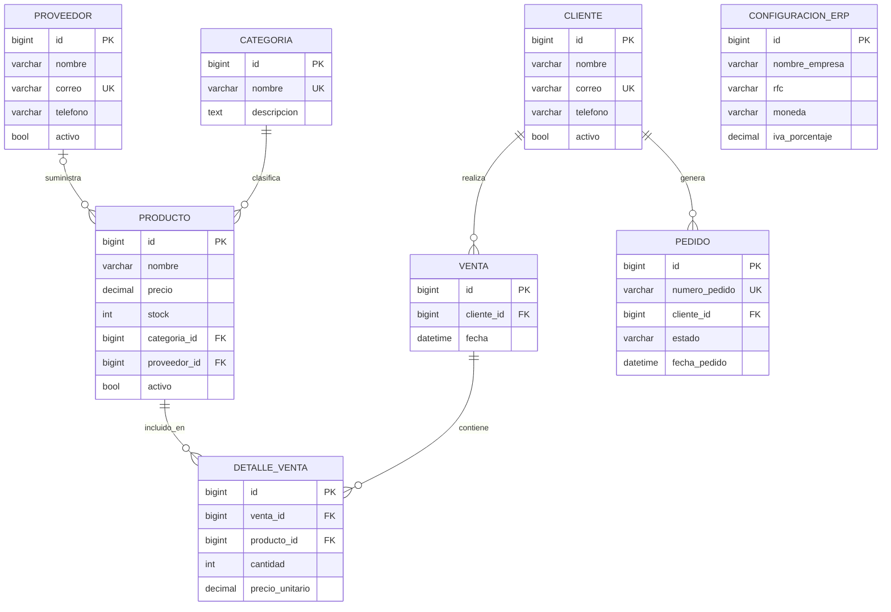

# Diagrama Entidad-Relación — ERP Django

## Espiral 2 · Modelo de datos

## Notas de diseño

- El total de Venta se calcula a partir de sus detalles.
- DetalleVenta conserva el precio histórico del producto.
- ConfiguracionERP está diseñada para tener una sola configuración global.
- Pedido se implementará en una etapa posterior.